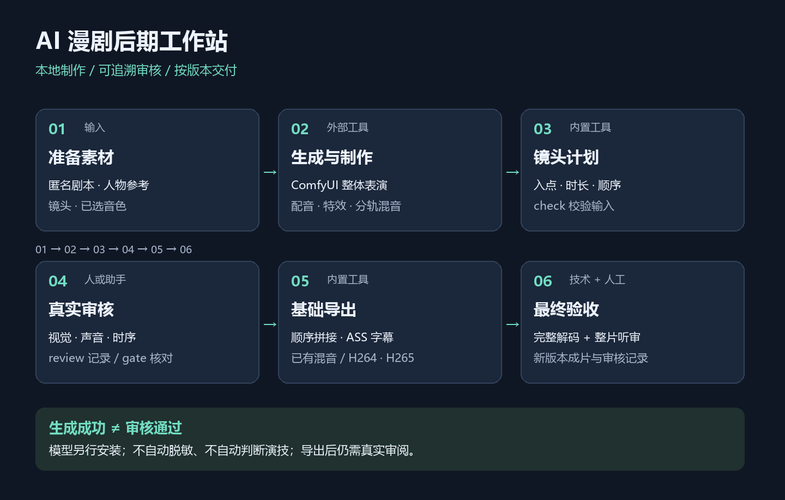
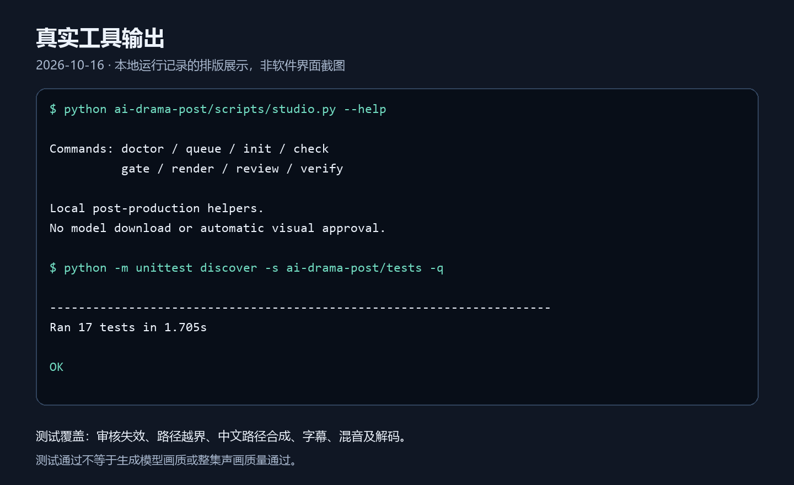

# AI 漫剧后期工作站 Skill

**`ai-drama-post` 是给 AI 助手使用的本地制作技能和 Python 辅助工具。** 它提供流程指导、审核记录与基础导出，不是独立剪辑软件，也不是一键生成整集的模型。



流程中的模型生成、配音和复杂特效由外部工具完成；本项目提供 skill 指导与明确列出的辅助命令。

## 1. 项目解决什么问题

AI 漫剧后期容易出现人物形象漂移、配音与镜头脱节、场景衔接突兀、人物介绍跨镜头错标，以及素材修改后继续沿用旧审核结果等问题。

本项目以镜头计划组织制作，保留原素材，记录实际审核证据及文件指纹，通过检查后导出待最终审阅的候选成片。生成成功、解码成功与艺术质量通过分别记录，避免混淆。

## 2. 主要功能

| 功能 | 当前实现 |
| --- | --- |
| 制作指导 | Skill 文档指导角色一致性、整体表演、配音、反应镜头、字幕、人物介绍与最终声画审核 |
| 环境检查 | `doctor` 显示 Python 版本和 FFmpeg / ffprobe 路径，不安装或修改环境 |
| 本地队列查询 | `queue` 只读查询本机 ComfyUI，不提交生成、不停止任务 |
| 初始化 | `init` 创建媒体/输出目录及示例计划，不生成素材 |
| 计划检查 | `check` 检查参数、项目内路径、视频取用时长、混音长度及 ASS 字幕输入 |
| 审核门禁 | `review` 记录实际完成的视觉、音频、时序检查；`gate` 核对审核项、镜头范围及 SHA256，媒体或范围改变后旧审核失效 |
| 基础导出 | `render` 按顺序截取拼接、缩放并居中裁切，合成已有混音和 ASS 字幕，支持 H264 / H265 MP4，拒绝覆盖已有输出 |
| 技术验证 | `verify` 完整解码并保存媒体流、时长及指纹报告；导出器还核对尺寸、帧率、编码和音轨规格 |

**能力边界：** 脚本不自动生成图片、视频、配音、音效或粒子特效，不自动修复嘴型，不执行真实超分或 AI 补帧。这些步骤由助手调用另行安装的工具完成，再输入已有镜头与混音。提高输出帧率可能仅重复帧，放大画幅也不等于恢复细节。审核命令保存检查声明，不具备自动视觉、听觉或隐私判断能力。

## 3. 安装方法

1. 安装 Python **3.10+**，通过 `python --version` 确认。
2. 安装 FFmpeg 和 ffprobe，并加入 `PATH`。导出需要 `libx264`，H265 需要 `libx265`，烧录字幕需要 `subtitles` / libass 支持。Python 脚本只使用标准库，无需安装 pip 依赖。
3. 解压本地发布包，在包含本 README 的目录打开终端，检查环境：

```sh
python ai-drama-post/scripts/studio.py doctor
python ai-drama-post/scripts/studio.py --help
```

`doctor` 只报告工具位置，不保证所有编码器、模型或插件可用。

将整个 `ai-drama-post/` 文件夹复制到支持 SKILL.md 的助手技能目录。Codex 通常使用 `~/.codex/skills/`，Windows 通常对应 `%USERPROFILE%\.codex\skills\`；自定义环境使用自己的配置。也可以不安装，让助手直接读取 [SKILL.md](ai-drama-post/SKILL.md)。

如需 AI 生成，另行准备 ComfyUI、本地模型、对应节点与可运行工作流；配音工具也需另行准备。本项目不附带模型或私人素材，不自动下载依赖或调用收费服务。

## 4. 使用方法

### 交给助手组织制作

提供剧本、匿名角色设定、参考图、镜头、配音与目标规格，例如：

> 使用 $ai-drama-post，完成匿名双人室内对话的后期。保留原素材，按新版本输出；生成优先使用本地 ComfyUI，表情和口型采用整体表演。角色只称“角色 A”和“角色 B”，字幕、文件名、审核记录和公开示例不含真实姓名或个人信息。先检查工具和素材，再制作并真实审核，待审候选不能称为最终成片。

### 基础导出流程

以下命令从项目根目录执行；安装到其他位置后调整脚本路径。

```sh
python ai-drama-post/scripts/studio.py init ./demo
```

初始化只生成目录和计划。把自己的镜头放入 `demo/media/` 并修改 `demo/plan.json` 后，再执行：

```sh
python ai-drama-post/scripts/studio.py check ./demo/plan.json

# 仅在真实完成对应检查后记录，不要直接照抄审核结论
python ai-drama-post/scripts/studio.py review ./demo/plan.json --clip shot01 --checks visual audio timing --evidence "已检查实际使用区间，证据见本地审核记录"

python ai-drama-post/scripts/studio.py gate ./demo/plan.json
python ai-drama-post/scripts/studio.py render ./demo/plan.json
python ai-drama-post/scripts/studio.py verify ./demo/renders/episode-v1.mp4
```

每个镜头都需审核，可分次记录 `visual`、`audio`、`timing`。无法听到声音时不要勾选音频检查。导出后仍需播放整片，复查口型、字幕、人物介绍、衔接和混音。

可选的本地 ComfyUI 队列查询：

```sh
python ai-drama-post/scripts/studio.py queue --url http://127.0.0.1:8188
```

查询失败时先检查本地服务是否启动，不代表模型损坏。格式详情见 [计划说明](ai-drama-post/references/plan-format.md)。

## 5. 输入输出示例

以下是**匿名室内对话示意**，不附带真实视频，也未使用私人视频截图。角色仅用 A/B 区分，示例台词不含姓名。

输入：

```text
demo/
  plan.json
  media/
    shot01.mp4       # 已制作的3秒室内动态镜头
    mix.wav          # 已完成混音，至少覆盖输出时长
    captions.ass     # 已制作ASS字幕，台词示例：我们再谈一次吧。
```

`plan.json`：

```json
{
  "version": 1,
  "output": "renders/episode-v1.mp4",
  "width": 720,
  "height": 1280,
  "fps": 24,
  "codec": "h264",
  "clips": [
    {"id": "shot01", "path": "media/shot01.mp4", "start": 0, "duration": 3}
  ],
  "mix": "media/mix.wav",
  "subtitles": "media/captions.ass"
}
```

路径相对 `plan.json` 所在目录，必须留在项目内。`mix` 和 `subtitles` 可省略；没有混音时保留镜头原声，无声镜头补静音。字幕文件需要自行制作，脚本不自动生成或脱敏。

输出：

```text
demo/
  reviews.json                        # 审核项、镜头范围、指纹和证据描述
  renders/
    episode-v1.mp4                    # 待最终声画审阅的候选成片
    episode-v1.verification.json      # 技术检查报告，不是艺术质量评分
```

失败时可能保留 `.partial.mp4`，不能当作成片。重试前检查原因并使用新的版本名。

## 隐私与公开示例

公开示例只用匿名角色、虚构台词或确认已脱敏的素材，不公开真实姓名、近音姓名、账户、私人路径、联系方式、声音参考或私人原片。截图、视频及字幕还需检查屏幕、招牌、片头片尾、文件名、元数据和音轨中的个人信息。**改成动漫风格不等于完成匿名化。**

工具目前不自动检测姓名或隐藏隐私，必须另外检查。历史制作文件不属于发布包，不要直接上传整个旧工作目录；应使用干净发布包 `dist/ai-drama-post.zip` 并复查内容。

## 测试与许可



上图为本地命令输出的排版展示，不是剪辑软件界面截图；使用匿名测试数据，不含私人素材或本地个人路径。

```sh
python -m unittest discover -s ai-drama-post/tests -v
```

本地验证记录见 [TESTING.md](ai-drama-post/TESTING.md)。缺少 FFmpeg / ffprobe 时集成测试明确跳过。测试不证明生成模型的画质、演技或整集混音质量。

代码及技能说明采用 [MIT](LICENSE)，外部模型、声音、字体和素材各自遵循其许可。项目可完全在本地开发与测试；不会自动创建远程仓库或上传 GitHub。
